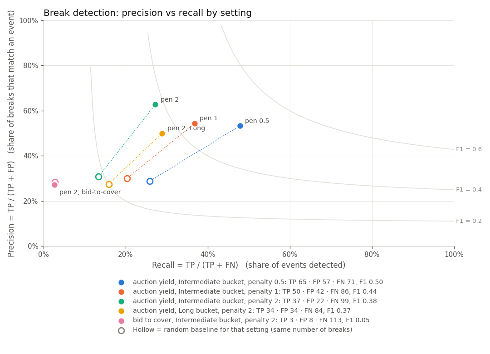

# Break detection results

One folder per setting tested by `breaks.py`; open a folder's README for recall by event, scores by country, the false positives and negatives, and the charts. Breaks are scored against `events.csv`, one break per event within ±6 months.

| Run | TP | FP | FN | Precision | Recall | F1 | Random F1 | p-value |
|---|:-:|:-:|:-:|:-:|:-:|:-:|:-:|:-:|
| [auction yield, Intermediate bucket, penalty 0.5](auction_yield_intermediate_pen0.5/) | 65 | 57 | 71 | 53% | 48% | 0.50 | 0.27 | ≤ 0.001 |
| [auction yield, Intermediate bucket, penalty 1](auction_yield_intermediate_pen1/) | 50 | 42 | 86 | 54% | 37% | 0.44 | 0.24 | ≤ 0.001 |
| [auction yield, Intermediate bucket, penalty 2](auction_yield_intermediate_pen2/) | 37 | 22 | 99 | 63% | 27% | 0.38 | 0.19 | ≤ 0.001 |
| [auction yield, Long bucket, penalty 2](auction_yield_long_pen2/) | 34 | 34 | 84 | 50% | 29% | 0.37 | 0.20 | ≤ 0.001 |
| [bid to cover, Intermediate bucket, penalty 2](bid_to_cover_intermediate_pen2/) | 3 | 8 | 113 | 27% | 3% | 0.05 | 0.05 | 0.672 |

| Term | Meaning here |
|---|---|
| True positive (TP) | a break matched to a known event within the window (±6 months for events.csv, ±3 for events_v2.csv) |
| False positive (FP) | a break with no event left to match (a lead, or noise) |
| False negative (FN) | a known event with no break matched to it (missed) |
| Precision | TP / (TP + FP): share of breaks that match an event |
| Recall | TP / (TP + FN): share of events that were detected |
| F1 | 2 × precision × recall / (precision + recall) |
| Random baseline | the same number of breaks per stretch at random dates, scored the same way (1,000 draws, average) |
| p-value | share of random draws with an F1 at least as high as the real one |
