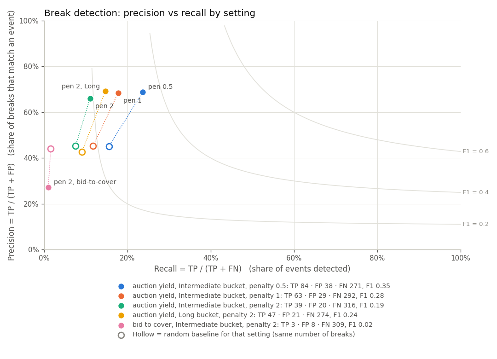

# Break detection results

One folder per setting tested by `breaks.py`; open a folder's README for recall by event, scores by country, the false positives and negatives, and the charts. Breaks are scored against `events_v2.csv`, one break per event within ±3 months.

| Run | TP | FP | FN | Precision | Recall | F1 | Random F1 | p-value |
|---|:-:|:-:|:-:|:-:|:-:|:-:|:-:|:-:|
| [auction yield, Intermediate bucket, penalty 0.5](auction_yield_intermediate_pen0.5/) | 84 | 38 | 271 | 69% | 24% | 0.35 | 0.23 | ≤ 0.001 |
| [auction yield, Intermediate bucket, penalty 1](auction_yield_intermediate_pen1/) | 63 | 29 | 292 | 68% | 18% | 0.28 | 0.19 | ≤ 0.001 |
| [auction yield, Intermediate bucket, penalty 2](auction_yield_intermediate_pen2/) | 39 | 20 | 316 | 66% | 11% | 0.19 | 0.13 | ≤ 0.001 |
| [auction yield, Long bucket, penalty 2](auction_yield_long_pen2/) | 47 | 21 | 274 | 69% | 15% | 0.24 | 0.15 | ≤ 0.001 |
| [bid to cover, Intermediate bucket, penalty 2](bid_to_cover_intermediate_pen2/) | 3 | 8 | 309 | 27% | 1% | 0.02 | 0.03 | 0.938 |

| Term | Meaning here |
|---|---|
| True positive (TP) | a break matched to a known event within the window (±6 months for events.csv, ±3 for events_v2.csv) |
| False positive (FP) | a break with no event left to match (a lead, or noise) |
| False negative (FN) | a known event with no break matched to it (missed) |
| Precision | TP / (TP + FP): share of breaks that match an event |
| Recall | TP / (TP + FN): share of events that were detected |
| F1 | 2 × precision × recall / (precision + recall) |
| Random baseline | the same number of breaks per stretch at random dates, scored the same way (1,000 draws, average) |
| p-value | share of random draws with an F1 at least as high as the real one |
