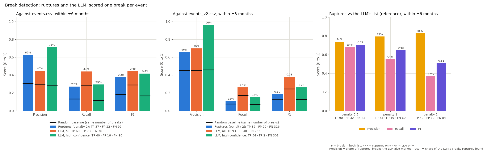

# LLM analysis vs ruptures

An LLM (Claude Opus 5.5, in a Claude Code session) read every country's
monthly 2-10 year auction yields and marked break dates and their causes
**before** ruptures was rerun on the same data. See [METHOD.md](METHOD.md)
for the rules and the file hash that shows the list wasn't edited afterwards.

The LLM's list was made on the run of 19 November 2026. The comparison below
uses the run of 22 November 2026, after a code review fixed several data
problems (Italian dates, Slovak yields for 2009-2016 that were missing
before, a Finnish typo and others; see the main README) and made ruptures
consider every month as a break date. The LLM's list wasn't redone, so it
has no Slovak breaks before 2017.

- [breaks.csv](breaks.csv): the LLM's 148 breaks, each with a cause and a confidence
- [comparison.csv](comparison.csv): LLM and ruptures breaks side by side (main setting)
- [comparison.json](comparison.json): the numbers below
- [llm_vs_ruptures.png](llm_vs_ruptures.png): the chart below
- Rebuild the numbers: `python model_testing/compare_llm.py`

## How it's scored

Same rules as `breaks.py` ([scoring.py](../../scoring.py)): one-to-one
matching within ±3 months of an event in [events_v2.csv](../../events_v2.csv)
(133 events, the main list) or ±6 months in [events.csv](../../events.csv)
(the first 14 events), and ±6 months between the two break lists;
TP = break matched, FP = break left unmatched,
FN = item in the reference left unmatched; precision = TP / (TP + FP),
recall = TP / (TP + FN), F1 their harmonic mean; each method against a
random baseline with the same number of breaks per stretch (1,000 draws).
Accuracy isn't used: almost every month is a true negative, so it would be
92-97% for any model.

Only the LLM's breaks that ruptures could have found count: inside a
stretch of data ruptures analyses, and not within 6 months of the
stretch's start or end (ruptures can't put a break there). That leaves 133
of the 148; of the other 15, 7 are in the last few months of data and the
rest near the edges of a stretch (Ireland, which auctions rarely, has 3).

## Headline

**Against known events, events_v2.csv** (±3 months, 355 country-event pairs):

| | TP | FP | FN | Precision | Recall | F1 | Random precision | Random F1 | p-value |
|---|:-:|:-:|:-:|:-:|:-:|:-:|:-:|:-:|:-:|
| Ruptures, penalty 2 (59 breaks) | 39 | 20 | 316 | 66% | 11% | 0.19 | 45% | 0.13 | 0.003 |
| LLM, all (133) | 93 | 40 | 262 | 70% | 26% | 0.38 | 45% | 0.25 | ≤ 0.001 |
| LLM, high confidence (56) | 54 | 2 | 301 | 96% | 15% | 0.26 | 46% | 0.13 | ≤ 0.001 |
| LLM, medium confidence (58) | 29 | 29 | 326 | 50% | 8% | 0.14 | 45% | 0.13 | 0.26 |
| LLM, low confidence (19) | 10 | 9 | 345 | 53% | 3% | 0.05 | 45% | 0.05 | 0.32 |

**Against the first list, events.csv** (±6 months, 136 country-event pairs):

| | TP | FP | FN | Precision | Recall | F1 | Random F1 | p-value |
|---|:-:|:-:|:-:|:-:|:-:|:-:|:-:|:-:|
| Ruptures, penalty 2 (59 breaks) | 37 | 22 | 99 | 63% | 27% | 0.38 | 0.19 | ≤ 0.001 |
| LLM, all (133) | 60 | 73 | 76 | 45% | 44% | 0.45 | 0.29 | ≤ 0.001 |
| LLM, high confidence (56) | 40 | 16 | 96 | 71% | 29% | 0.42 | 0.17 | ≤ 0.001 |
| LLM, medium confidence (58) | 19 | 39 | 117 | 33% | 14% | 0.20 | 0.18 | 0.43 |
| LLM, low confidence (19) | 1 | 18 | 135 | 5% | 1% | 0.01 | 0.08 | 1.00 |

(The events.csv numbers are a little lower than in the first version of
this page: euro-area events now apply to a country only from the day it
joined, so Lithuania no longer gets them before 2015.)

**Agreement, the LLM's list as reference** (TP = in both, FP = ruptures
only, FN = LLM only):

| Ruptures setting | TP | FP | FN | Precision | Recall | F1 | Recall of LLM high / medium / low |
|---|:-:|:-:|:-:|:-:|:-:|:-:|:-:|
| Penalty 0.5 | 90 | 32 | 43 | 74% | 68% | 0.71 | 89% / 57% / 37% |
| Penalty 1 | 73 | 19 | 60 | 79% | 55% | 0.65 | 68% / 48% / 37% |
| Penalty 2 | 49 | 10 | 84 | 83% | 37% | 0.51 | 48% / 31% / 21% |

- **They agree on the big breaks.** At penalty 2, 83% of ruptures' breaks
  are in the LLM's list (precision); ruptures finds 37% of the LLM's
  breaks (recall), and 48% of its high-confidence ones. At penalty 0.5 F1
  rises to 0.71.
- **The LLM's high-confidence breaks are almost all real events.** Against
  events_v2.csv, 54 of 56 are within 3 months of one (96%, random 46%),
  against 71% on the first list: most of their causes are a country's own
  central bank or politics, which the first list didn't have. Ruptures'
  precision stays about the same (66%). The medium and low-confidence
  breaks are no better than random on either list. Caveat: the LLM chose
  its breaks knowing the same history the events come from.
- **On causes they agree a little over half the time.** Of the 35 pairs
  where ruptures' break matches an event in events_v2.csv, the LLM's cause
  is dated within 3 months of that event in 20.

## Where they differ, and what it shows

**Ruptures misses some well-known episodes.** High-confidence LLM breaks that
ruptures could have found but didn't (FNs against the LLM's list) include the US taper tantrum (2013),
COVID in the US, UK, Canada, Norway, Poland and South Korea (2020), Italy's
euro crisis (2011), "whatever it takes" (2012) and the 2018 budget clash,
and Canada's 2015 oil shock. At penalty 2 only the biggest moves relative to
each country's 20-year range survive: the US fall from ~1.5% to ~0.3% in 2020
is small next to its 0-5% range. Lower penalties catch more of them.

**The first list's ±6 month matching sometimes credited the wrong event.**
Ruptures dates the Czech break to Nov 2021 and events.csv labels it "Russia
invades Ukraine" (Feb 2022). It came *before* the invasion; the LLM's
explanation, the CNB's hiking cycle from mid-2021, fits the date. Germany
Sep 2022 was labelled "Fed starts raising rates" where the ECB's own hikes
are the closer cause. events_v2.csv has each country's own central bank
events and a ±3 month window, so these are no longer credited to a global
event (the Czech break is now an FP, just over 4 months after the CNB's
first hike).

**Ruptures only (the 10 FPs against the LLM's list):** Germany 2009-10, Japan 2009-09, Norway
2010-03, Finland 2017-11 and 2018-11, Switzerland 2016-10, Belgium 2026-03,
plus three the LLM couldn't or didn't judge: Spain 2026-03 (the series only
starts in 2025, so the LLM skipped it) and Slovakia 2012-02 and 2014-03 (no
Slovak yields before 2017 when the LLM made its list).

## Problems found in the data

All found while preparing this analysis or in the code reviews that
followed, and fixed in the runs of 21-22 November 2026:

- **Break dates on a 5-month grid:** ruptures by default only tries every
  5th month as a break date (`jump=5`), which moved dates by up to 2 months
  (e.g. Poland Dec 2021 instead of Feb 2022). It now tries every month.

- **Finland:** the 17 Nov 2026 4-year auction is published at a yield of
  3,389% (almost certainly 3.389%). It gave ruptures a false break; such
  values are now left out as typos.
- **Gaps:** filling months without auctions used to reach across long gaps
  and invent values (e.g. Belgium Dec 2019-May 2020), and only each
  country's longest unbroken stretch was analysed. Now only gaps of up to 6
  months are filled, and every stretch of 18+ months is analysed.

Still true:

- **Belgium:** no 2-10 year auctions in 2020-2022, so the 2022 rise happens
  in a gap and can't be dated.
- **Finland, Ireland, Switzerland:** few auctions per year, so breaks there
  are dated less precisely.
- **Sep-Oct 2026:** yields jumped in most countries at once. This is after
  the LLM's knowledge cutoff (June 2026), so it names no cause.

## Caveats

- events_v2.csv was made by separate agents that saw no results, but they
  are the same model as the LLM here, with the same knowledge of history.
- The LLM is not fully independent: it wrote `events.csv` and saw an
  earlier set of ruptures results in the same conversation. Its causes come
  from its own knowledge and were not checked against sources.
- Judging breaks by eye is subjective and can't be rerun to give the same
  answer; ruptures can.
- Agreement on a cause is by timing (within 3 months), not by reading both
  explanations.

## Suggested next steps

- Done: country-specific events and merged clusters (events_v2.csv, see
  [events_v2_decisions.md](../../events_v2_decisions.md)).
- Report results at penalty 0.5 or 1 alongside penalty 2: they have a
  higher F1, against events and against the LLM's list.
- The merge rule dates a cluster at its first event, so a break near a
  later event in the cluster can miss (the US break of June 2022 is more
  than 3 months after the Ukraine invasion, which absorbs the Fed's first
  hike). Letting the biggest event in a cluster set the date would fix it.
- Redo the LLM's list on the current data (Slovakia 2009-2016 in particular).
